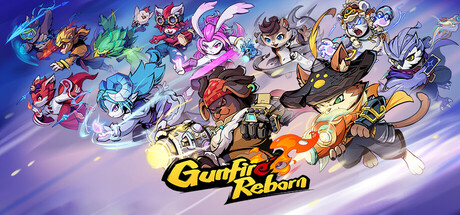

**Gunfire Reborn by Duoyi Games (2021) is a roguelite first-person shooter with hero characters and procedurally generated loot.**

---

## 📖 About

Gunfire Reborn by Duoyi Games (2021) is a roguelite first-person shooter with hero characters and procedurally generated loot. Each character has unique abilities that synergize with weapon inscriptions, creating build complexity that rivals Borderlands at its peak.

## ⚠️ Problems Without Trainer

| Problem | Status |
|---------|--------|
| Reincarnation levels require hundreds of runs to max out soul essence upgrades | ✅ Solved |
| Inscription synergies require specific weapon types that rarely drop together | ✅ Solved |
| Elite enemy modifiers on high reincarnation stack damage to one-shot levels | ✅ Solved |
| Ascension choice trees lock build direction after just a few picks | ✅ Solved |
| Boss encounters on R8+ require near-perfect build execution with zero error | ✅ Solved |

## ✅ Solution

The **Gunfire Reborn Trainer** solves all these issues, giving you complete control so you can focus on enjoying the game.

## 🎯 Features

- Unlimited Resources / Currency
- God Mode / Invincibility
- Instant Skill & Ability Cooldown
- One-Hit Kill
- Freeze Timers
- Unlock All Items & Achievements
- Custom Speed Multiplier
- Infinite Stamina / Energy

## 🚀 Quick Start

1. **Disable Windows Defender** temporarily (trainer may trigger false positive)
2. Get the trainer from the button above
3. Launch Gunfire Reborn
4. Run the trainer as Administrator
5. Use the hotkeys to activate cheats in-game

## 💎 Free vs Pro

| Feature | Free | Pro |
|---------|------|-----|
| God Mode | ✅ | ✅ |
| Unlimited Resources | ✅ | ✅ |
| Advanced Cheats | ❌ | ✅ |
| Auto-Updates | ❌ | ✅ |
| Priority Support | ❌ | ✅ |

## 💻 Requirements

- Windows 10 / 11 (64-bit)
- Gunfire Reborn (any version)
- .NET Framework 4.8+
- DirectX 11+

## 🍎 macOS

## ⚖️ Legal

Educational and single-player use only.

---

